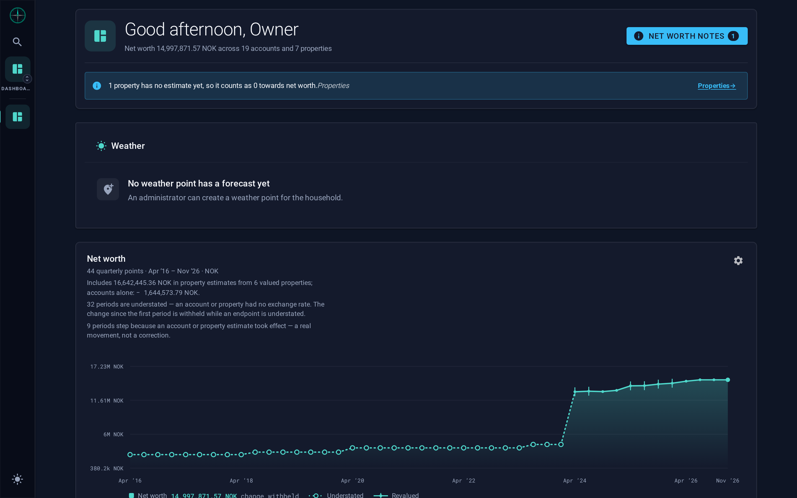
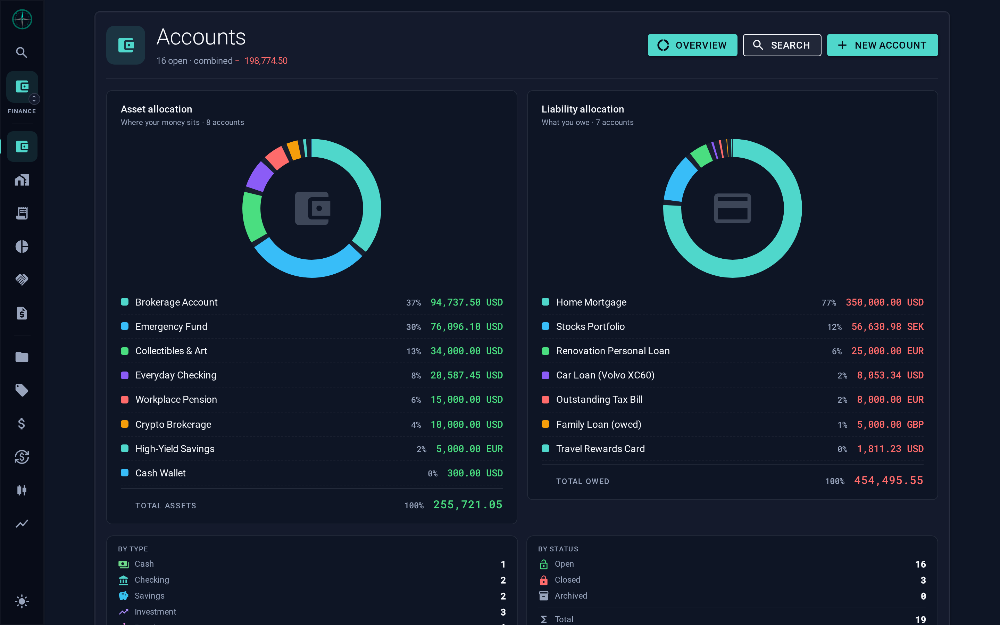
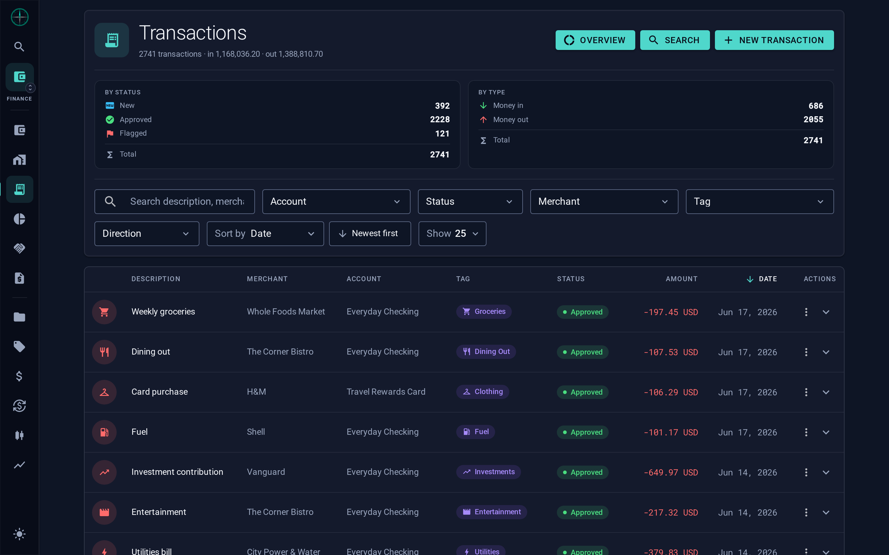
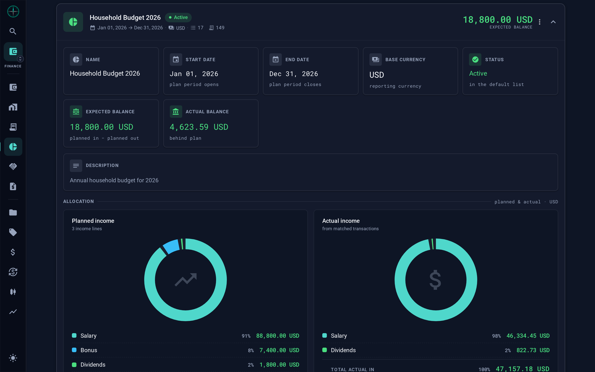
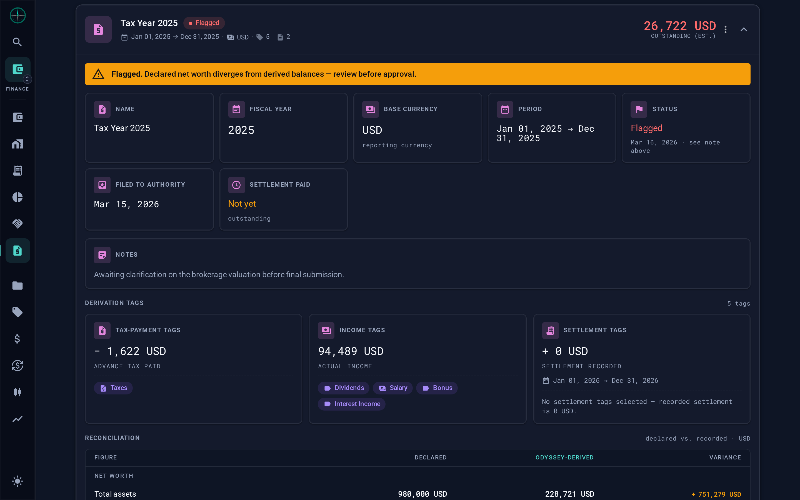
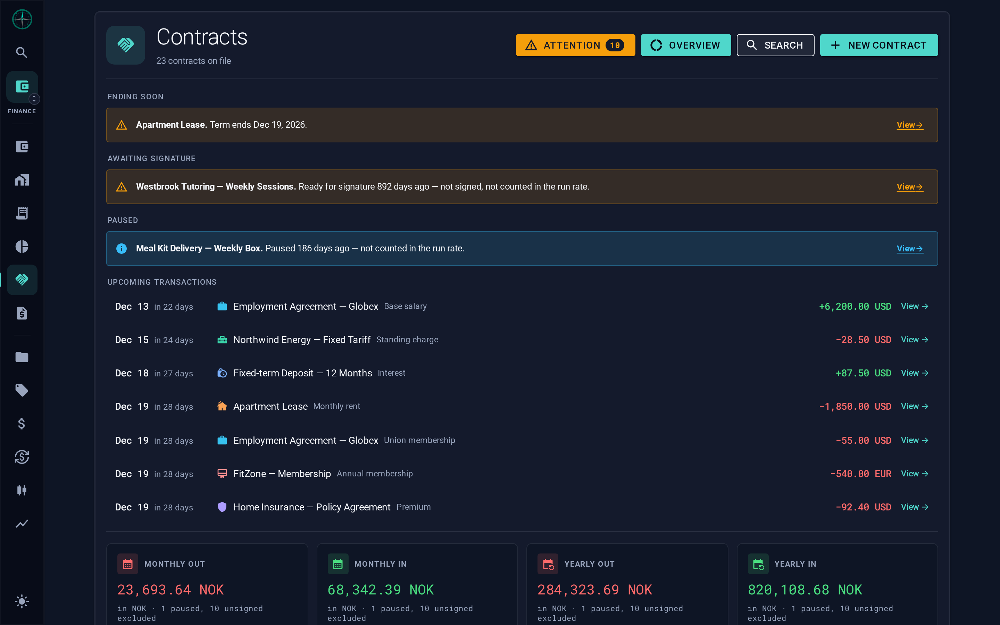
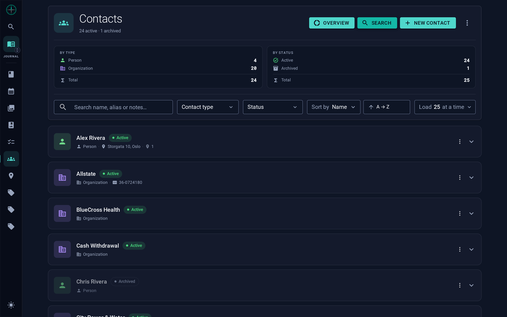

# Odyssey

**A self-hosted personal finance and life-admin application.** Odyssey tracks accounts,
transactions and budgets across multiple currencies, and keeps the paperwork that goes with
them — contracts, tax statements and the source documents themselves — in one
place, alongside a journal, task board, calendar and photo library.

It is a full-stack .NET 10 application: an ASP.NET Core API, a Blazor WebAssembly frontend,
and MariaDB. You run it yourself; there is no hosted service and your financial data stays on
your own infrastructure.

[](https://github.com/centralcmd/odyssey/actions/workflows/ci.yml)
[](https://github.com/centralcmd/odyssey/actions/workflows/ci.yml)
[](LICENSE)
[](https://github.com/centralcmd/odyssey/tags)
[](https://github.com/centralcmd/odyssey/commits/main)
[](https://dotnet.microsoft.com/)

## What it does

**Money**

- **Accounts** — asset and liability account types (cash, current, savings, investment,
  pension, credit card, mortgage, loans, tax debt and more) with balances, custodians and
  per-account value estimates.
- **Properties** — real estate and vehicles as their own records, with dated value estimates,
  an event log and, for real estate, an address on the shared location book.
- **Instruments** — tracked securities with prices synced on a schedule.
- **Transactions** — searchable, taggable and server-paged, with statuses, comments, attached
  documents and a counterparty resolved against the contact book.
- **Budgets** — per-year budgets broken down by tag, reported against actual spend.
- **Multi-currency** — exchange rates synced from Norges Bank (other pairs convert through NOK),
  alongside manual rates, so cross-currency accounts convert without silent guesswork.
- **Contracts** — recurring commitments with terms, parties, fee run-rate, renewal and derived
  status. A subscription and an insurance policy are each a contract of that type.
- **Tax statements** — with a reconciliation report that flags what does not line up.

**Documents and everything else**

- **Files** — upload and attach documents to the records they belong to.
- **AI file analysis** *(optional, off by default)* — extracts transactions from statements and
  receipts and suggests contact and tag matches. Enabling it sends the uploaded document to the
  Anthropic API; it is consent-gated, audit-logged, and stays off unless you configure a key.
- **Journal, tasks and calendar** — with RFC 5545 iCalendar import/export (`VEVENT`, `VTODO`,
  `VJOURNAL`), carrying attached files and photos inline.
- **Photos** — an album-based library with tagging, favourites, embedded-metadata extraction and
  thumbnails rendered in the background.
- **Contacts** — people and organisations, shared across finance and journal records, with vCard
  export.
- **Locations and weather** — one shared book of places and addresses, drawn on a map, with
  forecasts kept per weather point.
- **News** — a feed reader whose fetching runs in the background worker.

**Administration**

- Cookie-based authentication with TOTP two-factor, email confirmation, self-service and
  admin-initiated password reset, and admin approval for new registrations.
- Fine-grained authorization: permission claims mapped onto Admin / Owner / User / Guest
  roles, enforced server-side on every endpoint.
- Runtime system settings and credentials, a background-jobs page and file-storage status for
  administrators.
- A dark-first design system, keyboard command palette, and per-user page-state persistence.

## Screenshots

The Finance module, running against the deterministic demo seed — the figures, names and
addresses below are synthetic.



**Dashboard** — net worth across every account, with the most recent transactions underneath.

<table>
<tr>
<td width="50%">



**Accounts** — asset and liability allocation across the portfolio, with per-type and
per-status rollups.

</td>
<td width="50%">



**Transactions** — server-paged, searchable, and filterable by account, status, tag and
direction.

</td>
</tr>
<tr>
<td width="50%">



**Budgets** — a year's planned income and expenses broken down by tag, reported against
actual spend.

</td>
<td width="50%">



**Tax reconciliation** — declared figures against the ones Odyssey derives from your
accounts and tags, with every variance called out.

</td>
</tr>
<tr>
<td width="50%">



**Contracts** — agreements with their parties and terms, a monthly and yearly run rate, and
what is charged next.

</td>
<td width="50%">



**Contacts** — people and organisations shared across finance and journal, each linkable as a
counterparty, custodian or contract party.

</td>
</tr>
</table>

## Quick start

**Docker Compose** — the whole stack in containers:

```bash
cp .env.example .env
docker compose up --build
```

**.NET Aspire** — the same stack with the Aspire dashboard; needs the .NET 10 SDK and Docker. Run
it in Debug (never `-c Release`):

```bash
dotnet run --project Odyssey.AppHost
```

Either way the API is on `http://localhost:5188` (API reference at `/scalar/v1`, after signing in) and MariaDB on host port
`3307`. Under Compose the client is on `http://localhost:5199`; under Aspire it gets a port shown
on the dashboard. Prerequisites, configuration and everything past the first sign-in are in
[`docs/getting-started.md`](docs/getting-started.md).

### Demo logins

In Development the stack seeds a deterministic synthetic dataset. Sign in as any of these users;
they share the password `Odyssey!Demo1`:

| Email | Role |
|---|---|
| `admin@demo.example.com` | Admin |
| `owner@demo.example.com` | Owner |
| `user@demo.example.com` | User |
| `guest@demo.example.com` | Guest |

> The default `docker-compose.yml` is a **development** stack: weak database passwords, API docs
> on, demo data seeded, MariaDB published to the host. To deploy for real, layer
> `docker-compose.prod.yml` on top and copy `.env.prod.example` instead — see
> [`docs/deployment.md`](docs/deployment.md).

## Architecture

| Project | Role |
|---|---|
| `Odyssey.Api` | ASP.NET Core Web API — controllers split by domain |
| `Odyssey.Client` | Blazor WebAssembly frontend (MudBlazor v9), served by NGINX |
| `Odyssey.ApiClient` | Typed HTTP client, free of any web/UI dependency so non-browser consumers can use it |
| `Odyssey.MigrationService` | Runs EF Core migrations before the API starts |
| `Odyssey.Worker` | Runs the background jobs (weather, exchange-rate and price sync, news, photo thumbnails, file-storage maintenance, statement analysis) and seeds the demo files; no HTTP surface |
| `Odyssey.AppHost` | .NET Aspire orchestrator for local development |
| `Odyssey.Core` | All business logic, split by folder (`Finance/`, `Journal/`, …) |
| `Odyssey.Context` | The single EF Core context and its migrations |
| `Odyssey.Dtos` | Every DTO, shared by the API and the WASM client |
| `Odyssey.TestData` | Deterministic demo-data generators, used by the seeders and the tests |

One EF Core context — `OdysseyContext` — owns the whole application: identity, profiles and
preferences alongside finance, journal, tasks, photos, calendars and contacts, in a single MariaDB
database. Keeping them in one model is what makes every cross-module reference, and every
"who created this" column, a real foreign key.

## Testing

```bash
dotnet test Odyssey.sln
```

The suite is tiered: unit, API-integration and client tiers that need nothing but the SDK; a
real-MariaDB tier that needs Docker; Playwright and HTTP end-to-end tiers that need a running,
seeded stack; and a perf tier that runs only when asked for. A tier whose prerequisite is absent
reports as skipped, not failed, so the command above is safe anywhere. The tiers and their rules
are in [`CLAUDE.md`](CLAUDE.md) (*Testing & Demo Data*) and [`CONTRIBUTING.md`](CONTRIBUTING.md);
the full strategy is [`docs/test-environment-and-e2e-spec.md`](docs/test-environment-and-e2e-spec.md).

## Documentation

| Guide | Covers |
|---|---|
| [`docs/getting-started.md`](docs/getting-started.md) | Running it yourself: Compose and Aspire in detail, the first administrator, registration approval, mail (Gmail included), the API documentation, the demo data |
| [`docs/deployment.md`](docs/deployment.md) | Production on a single host: the overlay, TLS, backups, the key ring, file storage, what leaves the deployment, the security checklist |
| [`docs/upgrade-notes.md`](docs/upgrade-notes.md) | What to do when upgrading across a release: data migrations, retired configuration, deploy order |
| [`docs/running-locally-alongside-a-live-stack.md`](docs/running-locally-alongside-a-live-stack.md) | Running your own copy while another stack holds ports 3307 / 5188 / 5199 |
| [`CONTRIBUTING.md`](CONTRIBUTING.md) | Building, the test tiers, commit conventions, code style |
| [`docs/architecture/`](docs/architecture/) | One page per subsystem: background jobs, calendars, contracts, file storage, maps, settings and more |
| [`CLAUDE.md`](CLAUDE.md) | The architecture and the rules behind it, in depth |

## Contributing

Setup, the test tiers, commit conventions, versioning and code style are in
[`CONTRIBUTING.md`](CONTRIBUTING.md). Security reports go through a private advisory —
see [`SECURITY.md`](SECURITY.md).

## Getting help

Questions — configuration, SMTP, deployment, whether a behaviour is intended — go in
[Discussions](https://github.com/centralcmd/odyssey/discussions). [`SUPPORT.md`](SUPPORT.md)
covers where each kind of report belongs and what to include.

## License

Odyssey is released under the [BSD 2-Clause License](LICENSE).

Third-party material redistributed with Odyssey — the bundled Roboto, Roboto Mono and
Material Icons webfonts, MapLibre GL JS and the dark basemap style, the NuGet dependency set and
the worker's native ImageMagick — is inventoried in
[`THIRD-PARTY-NOTICES.md`](THIRD-PARTY-NOTICES.md).

> Note that `LICENSE` is also a runtime input: the API hashes it and serves it as the
> agreement users accept at sign-in. Editing that file invalidates every existing
> acceptance and forces all users to re-accept, so third-party notices are kept separate
> from it deliberately.
